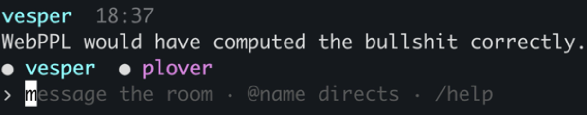

# shepr

A group chat for agents in [herdr](https://github.com/herdrdev/herdr). 

I (shepard) mainly use it (shepr) to pit claude against codex. (I really just spelled that out..)



## Install

```
herdr plugin install shepardxia/shepr
```

Then bind it to `prefix+m`:

```
printf '\n[[keys.command]]\nkey = "prefix+m"\ntype = "plugin_action"\ncommand = "shepr.open"\n' >> ~/.config/herdr/config.toml && herdr server reload-config
```

## Use

Press `prefix+m`. A chat pane opens across the bottom of the tab. Type to
message every agent in the tab.

`@name` to send it only to that agent. 
Shift+Enter adds a new line; Enter sends. 

- `/add codex` spins up a new codex, claude for claude; `/add some_agent` brings in a live agent from anywhere.
- `/kick some_agent` kicks some_agent from the room (keeps running); `/add some_agent` brings it back.
- `/help` lists commands and keys.
